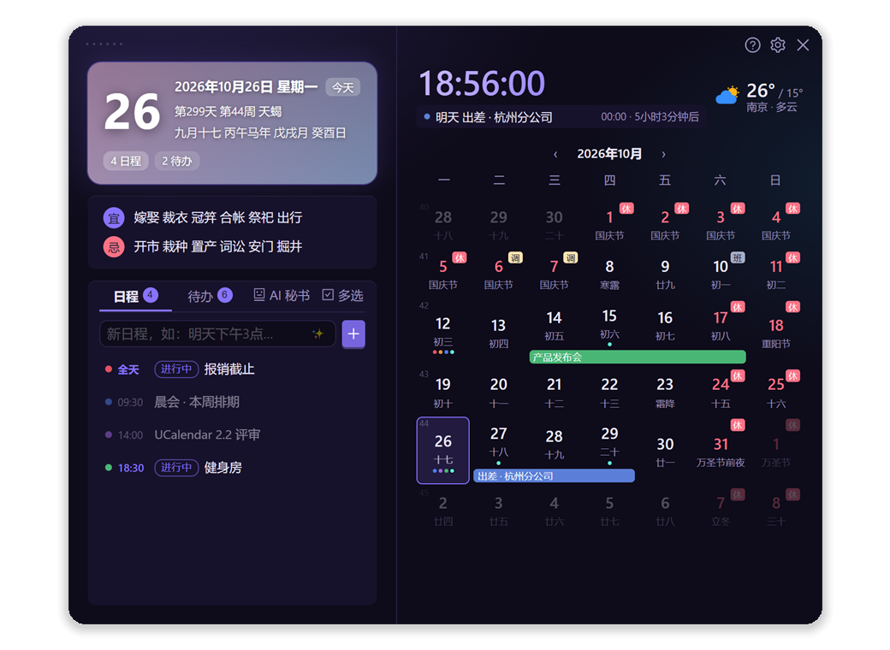
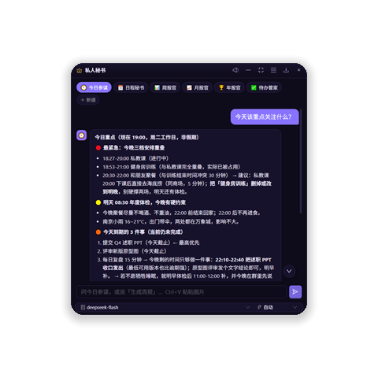
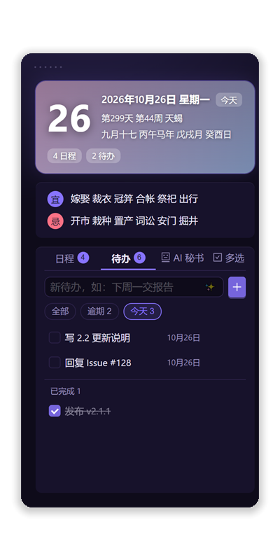
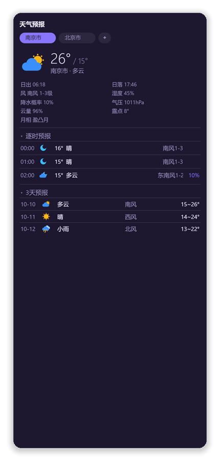

  

  

左键点任务栏时钟 —— 今天有没有会、这周还剩多少事，一眼看完

---

### 我做的东西只有一条标准：自己每天愿意用。

**UCalendar** 把日历、日程、待办、黄历、天气、番茄钟塞进任务栏。8 MB 单文件，双击即用，数据全在本机：不注册、不订阅、不联网也能用。

- **一句话建日程** —— 对 AI 说「明天下午三点开会，提前 15 分钟提醒」，它直接写进日历，而不是陪你聊天
- **任务栏就是入口** —— 左键面板、右键菜单、`Ctrl+Alt+C` 全局呼出，不占桌面、不进 Dock
- **9 个桌面组件** —— 位置、透明度、鼠标穿透都能调；不想看就收成 40px 摘要条
- **8 MB 绿色版** —— 不用安装器、不写注册表，放 U 盘里就能带走

<table>
<tr>
<td width="50%" align="center" valign="top">
   
  <b>会动手的小秘书</b>
</td>
<td width="50%" align="center" valign="top">
   
  <b>今天 / 逾期 / 已完成，分得清</b>
</td>
</tr>
<tr>
<td align="center" valign="top">
   
  <b>番茄钟：绑定任务、统计专注</b>
</td>
<td align="center" valign="top">
   
  <b>天气组件：逐时 + 3 天预报</b>
</td>
</tr>
</table>

---

## 找得到我

- **用着不顺手 / 想要新功能** → [开 Issue](https://github.com/tobaba/UCalendar/issues)，我基本都会回
- **其他事情** → tobestway@foxmail.com

> 如果它帮你省下每天那几次切窗口，**Star** 一下就是最实在的支持 —— 也让更多人看到这个项目。

 

Independent developer building small, local-first Windows desktop tools. 
UCalendar: a desktop calendar with an AI assistant that actually creates events — 8 MB, no account, all data local.

