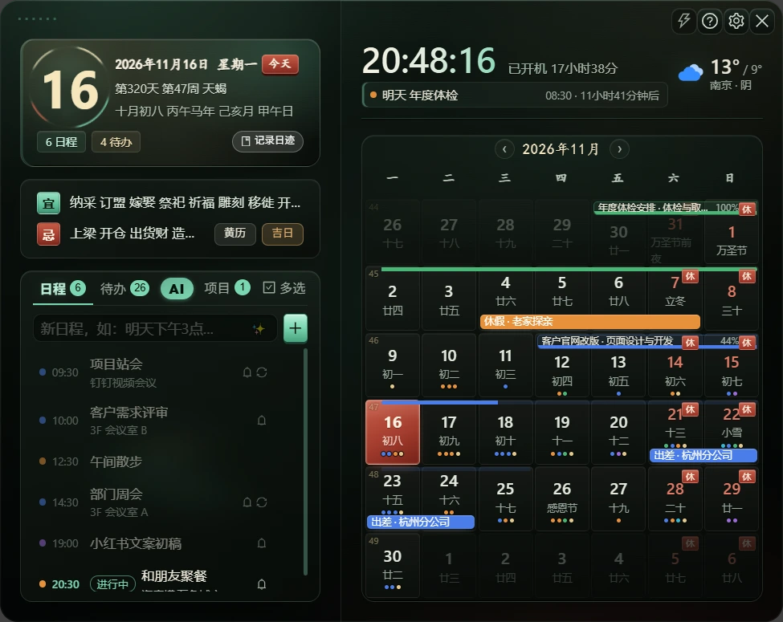
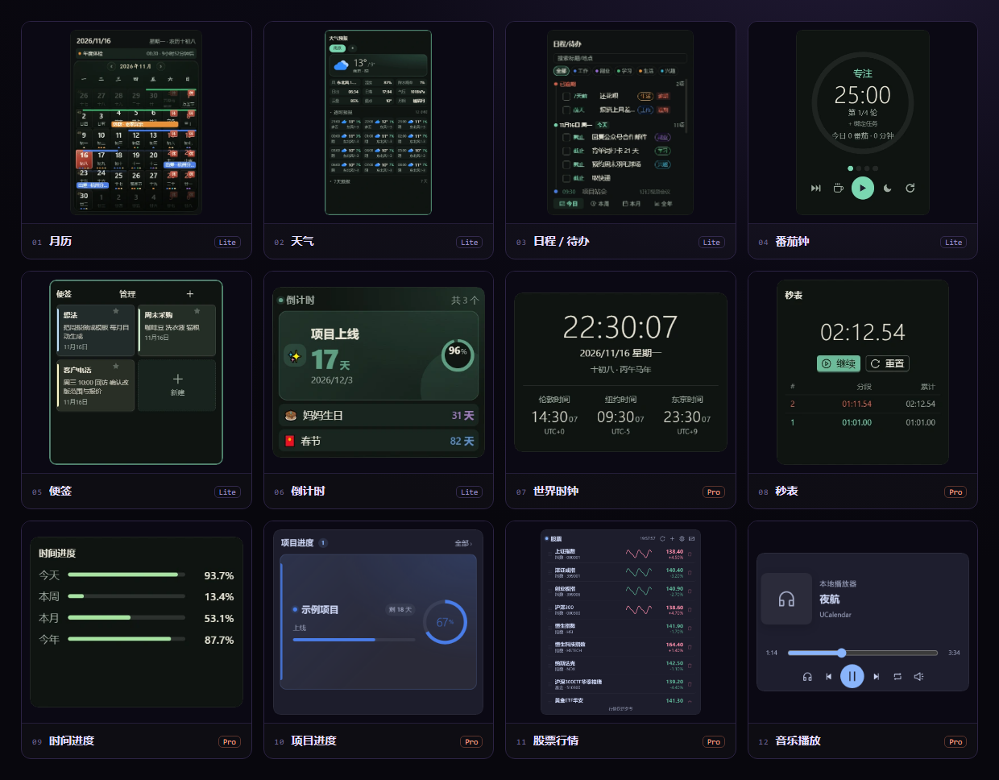

  

 

  <a href="https://tobaba.github.io/ucalendar-site/"><b>SITE</b></a>
  &nbsp;·&nbsp;
  <a href="https://github.com/tobaba/UCalendar"><b>UCALENDAR</b></a>
  &nbsp;·&nbsp;
  <a href="https://github.com/tobaba/ucalendar-lite"><b>LITE</b></a>
  &nbsp;·&nbsp;
  <a href="mailto:tobestway@foxmail.com"><b>MAIL</b></a>

## NOW

独立开发者，做 Windows 桌面工具。现在主要在做 **UCalendar**。

日程、待办、月历、便签和 AI 小秘书，收在任务栏旁边的一个面板里。数据留在本机，单文件，不登录。

  

点一下任务栏时钟，今天就在眼前。

## EDITIONS

**Pro** — 9 个桌面组件 · 21 套主题 · 日迹 / 时间册导出 / 今日节奏 
**Lite** — 6 个桌面组件 · 6 套主题 · 免费，保留日程 / 待办 / 月历 / 便签与 AI

[下载 Pro](https://github.com/tobaba/UCalendar/releases/latest) &nbsp;·&nbsp;
[下载 Lite](https://github.com/tobaba/ucalendar-lite/releases/latest) &nbsp;·&nbsp;
[版本说明](https://tobaba.github.io/ucalendar-site/#editions)

## WIDGETS

  

## PRINCIPLES

- **Local first** — 数据默认在自己的磁盘上；没有账号，没有云同步。
- **Small on purpose** — 单文件约 8 MB，双击运行，删掉 exe 即卸载。
- **Boring tech** — Tauri + Rust + React + SQLite；稳定比新潮重要。

## STACK

  
  
  
  
  
  

Windows 10/11 · 单文件 · 不写注册表 · 源码可构建

## ELSEWHERE

  <a href="https://github.com/tobaba/UCalendar">UCalendar</a> &nbsp;·&nbsp;
  <a href="https://github.com/tobaba/ucalendar-lite">Lite</a> &nbsp;·&nbsp;
  <a href="https://github.com/tobaba?tab=repositories">All repositories</a> &nbsp;·&nbsp;
  <a href="mailto:tobestway@foxmail.com">tobestway@foxmail.com</a>

