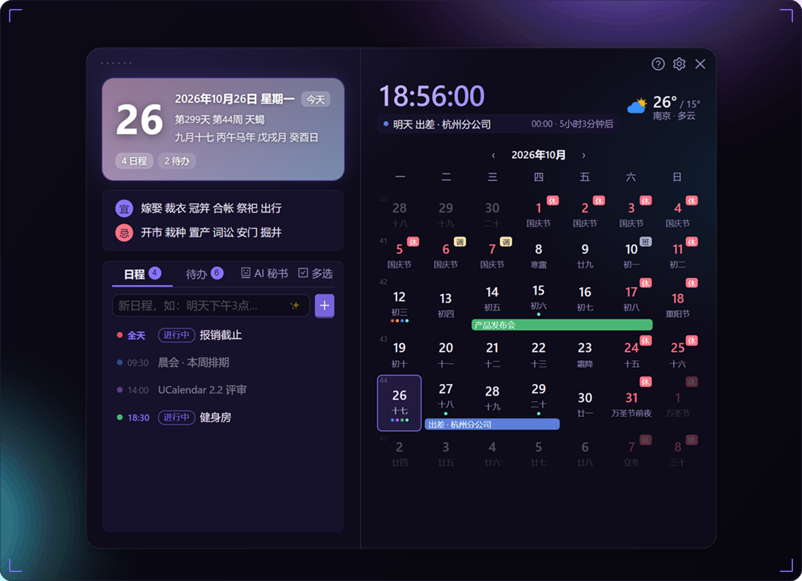
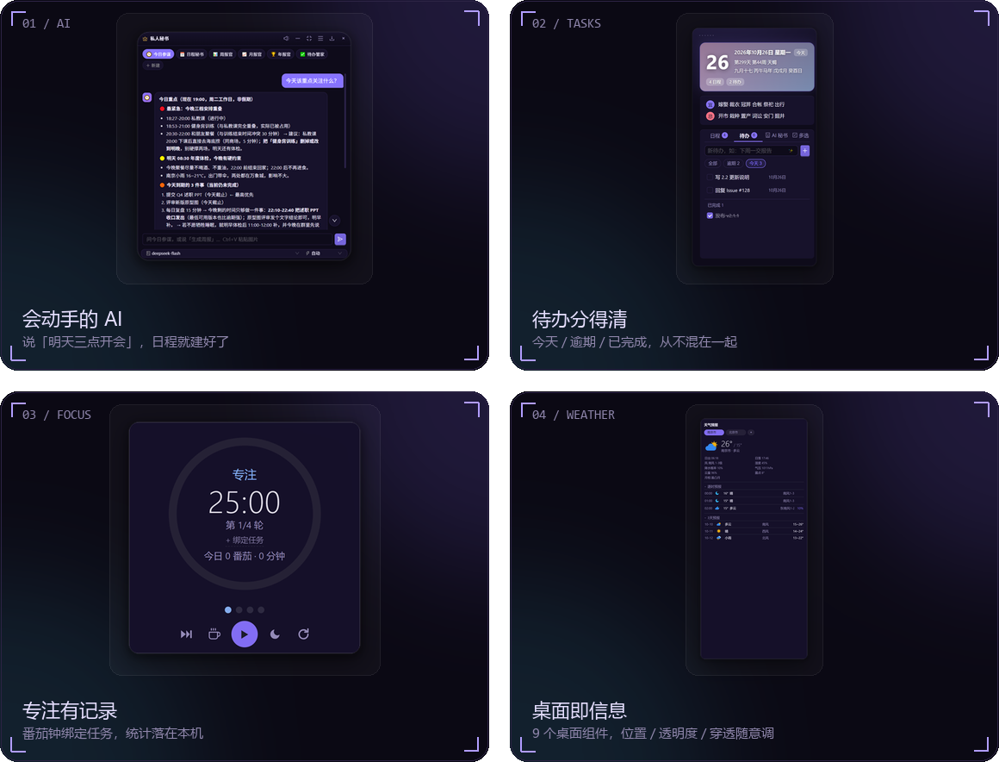
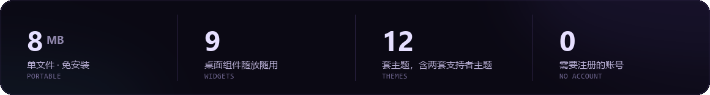

<div align="center">
  
</div>

<br>

<p align="center">
  <a href="https://tobaba.github.io/ucalendar-site/"><b>SITE</b></a>
  &nbsp;·&nbsp;
  <a href="https://github.com/tobaba/UCalendar/releases/latest"><b>DOWNLOAD</b></a>
  &nbsp;·&nbsp;
  <a href="https://github.com/tobaba/UCalendar"><b>SOURCE</b></a>
  &nbsp;·&nbsp;
  <a href="https://github.com/tobaba/UCalendar/issues"><b>ISSUES</b></a>
  &nbsp;·&nbsp;
  <a href="mailto:tobestway@foxmail.com"><b>MAIL</b></a>
</p>

## 01 — SHOWCASE

<p align="center">
  
</p>

<p align="center"><sub>左键点任务栏时钟 —— 今天有没有会、这周还剩多少事，一屏说完</sub></p>

## 02 — CAPABILITIES

<p align="center">
  
</p>

## 03 — WHY IT EXISTS

日历在系统里、日程在清单应用里、待办在便签里、天气在手机里 —— 一天要切四个地方。

UCalendar 把它们收进任务栏旁边的一个小面板：不点开时安静得像不存在，点开就是今天。

<p align="center">
  
</p>

不登录、不订阅、不联网照样能用 —— 数据全部留在本机，删掉 exe 即卸载。

```text
你：明天下午三点开会，提前 15 分钟提醒我
AI：已创建「开会」10 月 21 日 15:00（提醒 14:45），要现在写入吗？
你：好
AI：已写入日历
```

- **会查也会改**：问「这周还有哪些空？」「把周四健身改到晚上 8 点」
- **日报 / 周报 / 月报**：按真实日程与待办生成 Markdown
- **6 个预设助手** + 自定义智能体，可从我俩的聊天里自动提炼
- **DeepSeek / OpenAI 兼容 / Claude**，Key 只存本机；写数据、删数据、执行命令一律弹窗确认

## 04 — STACK

<p align="center">
  
  
  
  
  
  
</p>

<p align="center"><sub>单文件 8 MB · 不写注册表 · 删掉 exe 即卸载 · 源码可构建（<a href="https://github.com/tobaba/UCalendar#从源码构建">README</a>）</sub></p>

## 05 — ELSEWHERE

<p align="center">
  <a href="https://github.com/tobaba/UCalendar">UCalendar</a> &nbsp;·&nbsp;
  <a href="https://github.com/tobaba?tab=repositories">All repositories</a> &nbsp;·&nbsp;
  <a href="mailto:tobestway@foxmail.com">tobestway@foxmail.com</a>
</p>

<p align="center"><sub>如果它每天帮你省下那几次切窗口 —— Star 就是最实在的支持</sub></p>
